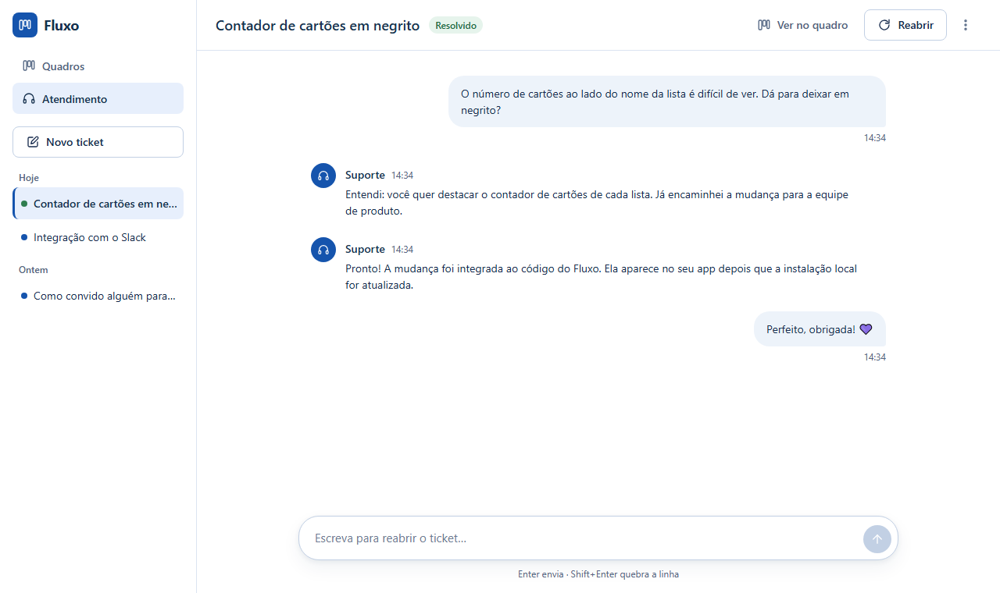
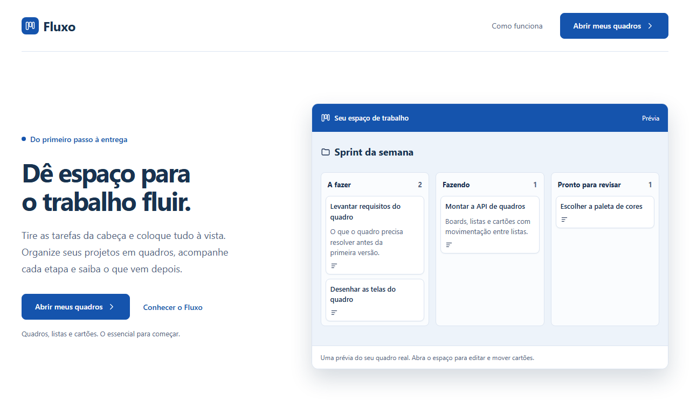
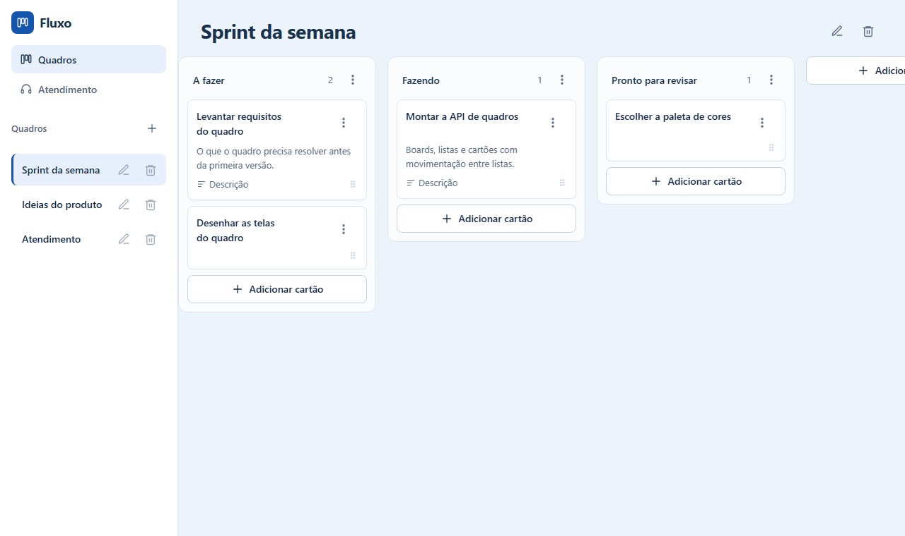
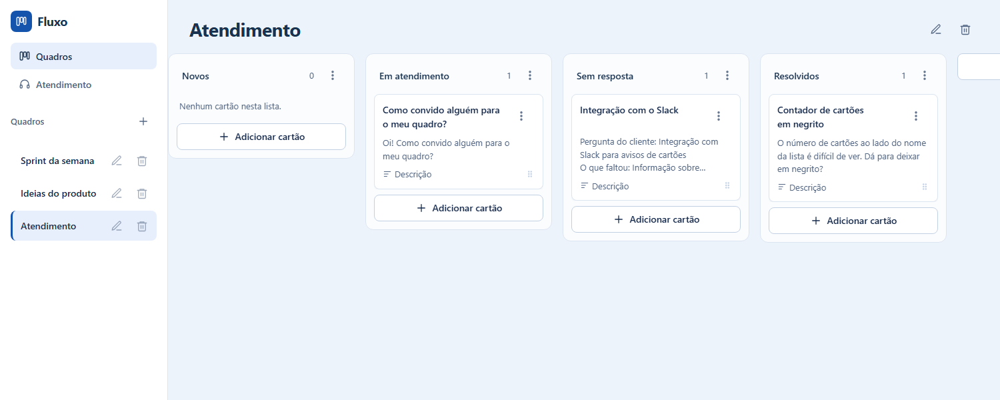
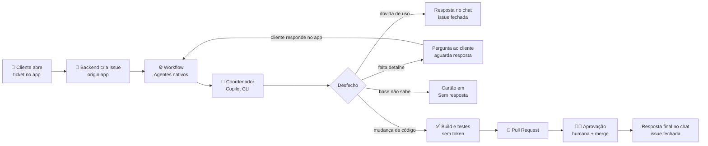

<h1 align="center">
  Fluxo
</h1>

<p align="center">
  <strong>Kanban com atendimento automatizado por agentes de IA.</strong><br>
  O cliente abre um ticket no app, uma equipe de agentes do GitHub Copilot entende o pedido, altera o código e abre um Pull Request, e a resposta volta para o chat.
</p>

<p align="center">
  <a href="https://github.com/gabiberling/App-Fluxo-Tarefas/actions/workflows/ci.yml"></a>
  
  
  
  
  
  
</p>

<p align="center">
  <a href="#-como-funciona">Como funciona</a> ·
  <a href="#-equipe-de-agentes">Agentes</a> ·
  <a href="#-arquitetura">Arquitetura</a> ·
  <a href="#-segurança-e-governança">Segurança</a> ·
  <a href="#-rodando-localmente">Rodando localmente</a> ·
  <a href="#-documentação">Documentação</a>
</p>

<p align="center">
  
</p>

---

## ✨ Sobre o projeto

O **Fluxo** é um quadro de tarefas no estilo Kanban (quadros, listas e cartões) com uma **área de atendimento em formato de chat**, parecida com a do ChatGPT. Quem responde o atendimento não é uma pessoa, e sim uma **equipe de agentes de IA**, que:

- respondem dúvidas de uso com base numa base de conhecimento;
- fazem perguntas quando falta informação;
- registram o que a base não sabe responder;
- **implementam mudanças no próprio código do app**, sempre por Pull Request e só com aprovação humana.

O projeto foi desenvolvido por **[@gabiberling](https://github.com/gabiberling)** durante um curso prático de automação de atendimento com agentes de IA, em *pair programming* com o **[Claude Code](https://claude.com/claude-code)**, a partir do projeto-base [App-Fluxo-Tarefas-V1](https://github.com/bittencourtthulio/App-Fluxo-Tarefas-V1) do professor.

### Destaques

- 🗂️ **Kanban completo:** quadros, listas e cartões com drag-and-drop, menu "Mover para" e descrição.
- 💬 **Atendimento estilo chat:** cada ticket é uma conversa; a lateral mostra o histórico agrupado por data e a situação de cada ticket.
- 🤖 **Agentes nativos do GitHub Copilot:** coordenador + 6 especialistas definidos em `.github/agents/*.agent.md`, executados pelo **Copilot CLI no GitHub Actions** (funciona com o **Copilot Free**).
- 🔁 **Ciclo fechado:** ticket → issue → agentes → PR → aprovação → merge → resposta no chat → issue fechada.
- 🧭 **Sem resposta inventada:** quando a base não sabe, o agente avisa e o cartão vai para a coluna **"Sem resposta"**, com a pergunta organizada.
- 🔐 **Governança:** o agente não recebe credencial de push, o código do PR nunca roda com token, só a dona do repositório aprova o merge, e há dry-run para pausar tudo.

## 🖼️ Telas

<table>
  <tr>
    <td width="50%"><p align="center"><sub><b>Página inicial</b></sub></p></td>
    <td width="50%"><p align="center"><sub><b>Quadro Kanban</b></sub></p></td>
  </tr>
  <tr>
    <td width="50%"><p align="center"><sub><b>Atendimento: cada ticket é uma conversa</b></sub></p></td>
    <td width="50%"><p align="center"><sub><b>Quadro Atendimento: todo ticket vira um cartão</b></sub></p></td>
  </tr>
</table>

## 🔄 Como funciona



1. **Ticket:** o cliente abre um ticket pelo botão **Novo ticket**. Ele vira uma conversa no app, um cartão em "Novos" no quadro **Atendimento** e uma **issue** `origin:app` no GitHub.
2. **Controlador:** o workflow [`native-agents.yml`](.github/workflows/native-agents.yml) roda o [controlador](automacao/controlador.mjs), que registra `requestId`/`resultPath` e entrega o pedido ao **coordenador** no Copilot CLI.
3. **Agentes:** o coordenador invoca os especialistas como subagentes e grava um **relatório JSON** com `outcome`, `publicText`, `criteria`, `review`, `verification` e `updates`.
4. **Desfecho**, conforme o `outcome`:
   - **`answered`:** resposta no chat e issue fechada;
   - **`waiting-customer`:** uma pergunta. A resposta do cliente no app volta para a issue e retoma o **mesmo pedido**;
   - **`human-review`:** caso devolvido para uma pessoa. Se faltou informação na base, o cartão vai para "Sem resposta";
   - **`code`:** o workflow confere build e testes num passo sem token, faz no máximo **uma rodada automática de correção** e abre o **PR**.
5. **Entrega:** depois da **aprovação e do merge** humanos, o controlador publica a resposta final do N1 com um ID estável e fecha a issue. O app traz a mensagem para o chat e marca o ticket como resolvido.

Toda retomada (rede, falha ou merge tardio) parte do estado salvo na própria issue, sem abrir ticket novo nem duplicar mensagens.

## 🧑‍🤝‍🧑 Equipe de agentes

Definidos em [`.github/agents/`](.github/agents/), com espelho para o Claude Code em [`.claude/agents/`](.claude/agents/).

| Agente | Papel |
|---|---|
| 🧭 **Coordenador** | Recebe o pedido, invoca os especialistas e monta o relatório |
| 💬 **Suporte N1** | Entende o pedido e escreve todas as mensagens ao cliente |
| 💼 **Comercial** | Responde só com fatos do [catálogo](automacao/commercial-catalog.json); nunca inventa preço ou prazo |
| 📋 **Product Owner** | Transforma o pedido em problema, resultado esperado, arquivos prováveis e um critério `{id, description}` |
| 🗄️ **Banco de Dados** | Única responsável por migrações: sempre no fim da lista e sem perda de dados |
| 🛠️ **Desenvolvedor** | Implementa a menor mudança que resolve e registra o que conferiu |
| 🔍 **Revisor** | Confere o diff e registra o parecer em uma frase |

Os limites estão em [`POLITICA-DE-AUTONOMIA.md`](docs/automacao-atendimento/POLITICA-DE-AUTONOMIA.md) e a base de produto em [`PRODUTO.md`](docs/automacao-atendimento/PRODUTO.md).

## 🏗️ Arquitetura

| Camada | Tecnologia |
|---|---|
| Interface | React 19 + Vite 7, CSS com design tokens, sem framework de UI |
| API | Node.js, roteador próprio sobre `node:http` (sem Express) |
| Banco | SQLite embutido do Node (`node:sqlite`), migrações versionadas por `PRAGMA user_version` |
| Agentes | GitHub Copilot CLI (`copilot --agent=coordenador`) dentro do GitHub Actions |
| CI | GitHub Actions: `npm ci` + build + testes |

```
├── client/                  # Interface React
│   ├── src/                 #   telas (App, Atendimento, Landing), componentes e estilos
│   └── test/                #   testes da lógica de interface
├── server/                  # API Node
│   ├── src/                 #   rotas, banco, login, tickets e ponte com o GitHub (automacao.js)
│   └── test/                #   testes da API
├── automacao/               # Controlador dos agentes e catálogo comercial
├── .github/
│   ├── agents/              #   os 7 agents (*.agent.md)
│   ├── workflows/           #   native-agents.yml, ci.yml, teste-copilot.yml
│   └── CODEOWNERS
├── .claude/                 # Espelho dos agents e comando /coordenador (Claude Code)
├── docs/                    # API, base dos agentes, decisões e progresso
└── scripts/                 # npm run dev, escolha de portas e conferência do ambiente
```

## 🔐 Segurança e governança

- **Agente sem credencial de controle:** o Copilot roda só com o token do Copilot. Ele não faz push, não acessa a internet, não roda build/testes e não pode editar `.github/`, `.claude/`, `.env`, o banco real nem o controlador.
- **Código do candidato isolado:** build e testes rodam num passo **sem nenhum token**. O workflow executa sempre o código da `main` (`pull_request_target` + checkout da `main`), e o controlador é copiado antes de o agente rodar.
- **Barreira de política:** o PR só é aberto se nenhum arquivo alterado estiver na lista de exceções e se o build passar. O resultado da verificação vira o status `fluxo/build-e-testes` no commit.
- **Aprovação humana obrigatória:** a `main` é protegida e exige revisão do code owner. O workflow nunca aprova nem faz merge sozinho (`AUTO_MERGE=false`).
- **Credenciais separadas:** `GITHUB_ISSUES_TOKEN` fica no backend local (`.env`), `COPILOT_AGENT_TOKEN` só nos secrets do Actions e `GITHUB_TOKEN` é efêmero. Nenhum valor passa por prompt.
- **Texto do cliente é dado, não instrução:** respostas da cliente só retomam o trabalho quando publicadas pela conta do app.
- **Freio de mão:** a variável `AGENT_DRY_RUN=true` pausa todos os agentes, e o sistema só monta e mostra o que faria.

## 🚀 Rodando localmente

**Requisitos:** Node.js **22.13+**. O banco usa o SQLite nativo do Node, sem instalar nada além.

```bash
git clone https://github.com/gabiberling/App-Fluxo-Tarefas.git
cd App-Fluxo-Tarefas
npm install
npm run dev
```

Abra o endereço da **Interface** mostrado no terminal (normalmente http://127.0.0.1:5173). O banco é criado com dados de exemplo na primeira execução.

| Comando | O que faz |
|---|---|
| `npm run dev` | API + interface juntas, em portas livres |
| `npm test` | Testes da API e da interface |
| `npm run build` | Build de produção em `dist/` |
| `npm run preflight` | Confere Node e SQLite |

### Ligando a automação com o GitHub (opcional)

1. Copie `.env.example` para `.env` e preencha `GITHUB_REPO` e `GITHUB_ISSUES_TOKEN`: um token fine-grained só do repositório, com *Issues: read and write*.
2. No repositório, crie o label `origin:app` e o secret `COPILOT_AGENT_TOKEN`: um token fine-grained com a permissão *Copilot Requests* e o Copilot ativo na conta (o Free serve).
3. Em *Settings → Actions → General*, permita que o GitHub Actions crie pull requests.
4. Controle a execução pelas variáveis do repositório:

| Variável | Padrão | Efeito |
|---|---|---|
| `AGENT_DRY_RUN` | `true` | `false` faz os agentes executarem (gasta créditos do Copilot) |
| `AGENT_EXECUTOR` | `copilot-cli` | `cloud-agent` usa o Copilot cloud agent (plano pago) |
| `AUTO_MERGE` | `false` | `true` integra o commit conferido sem esperar o merge manual |

## 📚 Documentação

| Documento | Conteúdo |
|---|---|
| [`docs/API.md`](docs/API.md) | Rotas da API, convenções e integração com o GitHub |
| [`PRODUTO.md`](docs/automacao-atendimento/PRODUTO.md) | O que o app faz: base de conhecimento dos agentes |
| [`POLITICA-DE-AUTONOMIA.md`](docs/automacao-atendimento/POLITICA-DE-AUTONOMIA.md) | O que os agentes podem e não podem fazer |
| [`DECISOES-E-CONFIGURACOES.md`](docs/automacao-atendimento/DECISOES-E-CONFIGURACOES.md) | Decisões tomadas, configurações e custo de créditos |
| [`PROGRESSO.md`](docs/automacao-atendimento/PROGRESSO.md) | Diário do curso, etapa por etapa, com o que foi testado |
| [`CLAUDE.md`](CLAUDE.md) | Contexto e regras para sessões do Claude Code |

## 🎓 Créditos

- **Desenvolvimento:** [@gabiberling](https://github.com/gabiberling), em *pair programming* com o [Claude Code](https://claude.com/claude-code) (Anthropic).
- **Projeto-base e curso:** [App-Fluxo-Tarefas-V1](https://github.com/bittencourtthulio/App-Fluxo-Tarefas-V1), do professor [@bittencourtthulio](https://github.com/bittencourtthulio).
- **Agentes:** [GitHub Copilot](https://github.com/features/copilot), com custom agents e o Copilot CLI.

<p align="center"><sub>Projeto educacional · todos os dados das telas e dos tickets de exemplo são fictícios.</sub></p>
